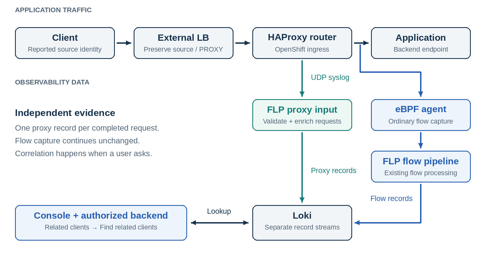
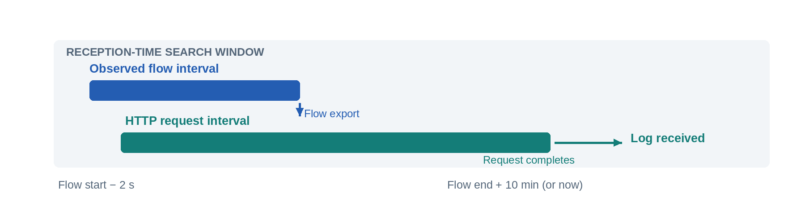

# External flow correlation

## Architecture for correlating external clients with backend flows in NetObserv

**Design review · 29 October 2026 · Initial implementation**

*Updated 2 November 2026: shared architecture, current HAProxy integration and validation.*

### 1. Purpose and architecture

A backend flow identifies a connection from a proxy to an application. When a load balancer, ingress controller or gateway forwards requests through a separate backend connection, the flow alone cannot explain which clients used that connection. Connection reuse can also associate several clients with the same backend flow.

This design adds proxy request records as a second source of evidence. A source integration translates the proxy's observations into a shared record model: the reported client endpoint, the backend connection tuple, a request interval and source identity. NetObserv stores these records separately from flows and looks up related clients when an administrator opens a backend flow.

The architecture is intended to accommodate multiple proxy implementations and collection mechanisms. The first integration uses HTTP access logs from the OpenShift HAProxy router. The deployment examples, diagrams and validation results in this document describe that implementation. Future integrations, including proxies configured through Gateway API, would provide their own source contracts while preserving the meaning of the normalized records.



*Figure 1. The current HAProxy integration illustrates the shared architecture: traffic forwarding continues independently of correlation, proxy records and ordinary eBPF flows reach separate Loki streams, and the console correlates them at query time.*

The eBPF agent continues capturing ordinary flows; source integrations supply the additional correlation evidence. In the HAProxy implementation, configured access logs replace the earlier uprobe prototype. No new agent capability, hostPID access or HAProxy process instrumentation is required for this integration.

**Available today:** the OpenShift HAProxy router with HTTP, edge termination and reencrypt Routes. The lookup requires Loki and administrator access. TLS passthrough is excluded from this integration. Gateway API implementations and other proxy sources are future extensions, with no current receiver or configuration example implied here.

<!-- pagebreak -->

### 2. Connection and record model

#### Two legs, two different meanings

A proxy observes a frontend leg and a backend leg. The frontend describes the reported client and the destination it reached. The backend describes the socket the proxy opened to the application. The current correlation model uses the complete backend TCP tuple: source IP, source port, destination IP, destination port and protocol. A source must expose both legs to relate a reported client to a captured backend flow.

| Endpoint | Normalized fields | Current HAProxy mapping |
| --- | --- | --- |
| Reported client | `ProxyClientAddr`, `ProxyClientPort` | `%ci`, `%cp` |
| Frontend destination | `ProxyFrontendAddr`, `ProxyFrontendPort` | `%fi`, `%fp` |
| Backend local socket | `SrcAddr`, `SrcPort` | `%bi`, `%bp` |
| Application endpoint | `DstAddr`, `DstPort` | `%si`, `%sp` |

The reported client is only as informative as the identity available to the proxy. If an upstream LB preserves the source address, PROXY protocol is unnecessary for that purpose. If it replaces the source address, a configured mechanism must carry the original identity; otherwise, the proxy reports the LB. The current HAProxy integration supports this propagation through explicitly configured PROXY protocol and does not infer client identity from X-Forwarded-For. Any future source must define how its client identity is obtained and trusted.

#### One request is not one TCP connection

For example, the flow `10.128.0.20:41000 → 10.129.0.30:8080` can carry several requests over a reused backend connection. Each request retains its own reported client and time interval. When different reported clients share that connection, the result can contain several clients.

The console therefore returns observed client endpoints and request counts; it does not write a single “original client” onto the flow. Flow bytes and packets remain measurements of the backend connection, with no per-client byte allocation.

#### Metadata retained with each request

The record discriminator is `_RecordType=proxyRequest`. `ProxyStartMs` and `ProxyEndMs` describe the request interval; `TimeReceived` records collection time. `ProxyInstance`, `ProxyProcess` and `ProxyRequestID` identify the emitting instance and request, supporting deduplication without treating a proxy-local counter as globally unique. In the HAProxy source, request identity scopes the counter to the router, process and request start time. `ProxySchemaVersion=1` identifies the current record contract.

The versioned payload contains connection metadata. It excludes URLs, headers, cookies and bodies. Kubernetes enrichment adds resource context for the backend, application, reported client and frontend addresses when those addresses resolve in the cluster cache.

<!-- pagebreak -->

### 3. Correlation at query time

#### Collection and lookup are independent

The source ingestion path validates incoming evidence and normalizes its endpoints, timing and identity. FLP enriches the addresses and writes a proxy record to Loki. This path bypasses flow conntrack, flow deduplication, flow metric generation and IPFIX export. Its stream uses `app=netobserv-proxy`; ordinary flow queries retain their existing stream selection. The current HAProxy receiver accepts UDP syslog; other transports would belong to their respective source integrations.

No flow-to-request join or correlation cache runs in FLP. This avoids buffering flow exports while waiting for a request to finish and preserves the one-to-many relationships in the source data. It also means correlation is an investigation feature, rather than a promise of immediate attribution for active requests.

From **Related clients → Find related clients**, the console backend:

1. Checks administrator access and whether the feature and Loki are enabled.
2. Validates the flow endpoints and interval, rejecting unsupported network scope.
3. Queries proxy records for the complete backend tuple in either direction, with overlapping request intervals.
4. Applies cluster identity when supplied, requiring it in multi-cluster mode.
5. Deduplicates request IDs and returns clients together with lookup coverage and limit indicators.

#### Investigating a flow in the console

As an administrator, open **Observe → Network Traffic → Traffic flows** with Loki as the data source. Filter for a backend TCP connection from the proxy to the application. For the current OpenShift HAProxy integration, clear any default quick filters that exclude ingress traffic, then filter by the application's destination name or namespace and the router's source namespace, `openshift-ingress`. Node health checks and the client-to-LB connection are different flows.

In the **Flow information** drawer, the tabs are **Details → Raw → Related clients**. Select the last tab and click **Find related clients**. Each observed client endpoint appears in a compact card with its request count, first and last request timestamps, and router instances. Dates include milliseconds. Long endpoint and router names wrap within the panel, which uses the same spacing as the other drawer panels. Results appear before the coverage notice and the search start/end fields.

The tab requires an eligible TCP flow with complete endpoints and timestamps, Loki and the correlation feature enabled, and a cluster-wide console context. User-defined networks remain unsupported. Empty UDN values such as `Udns: ["", ""]` represent no UDN scope and do not prevent the tab from appearing or add a UDN filter to the lookup.

#### Request time and reception time serve different purposes

Correlation distinguishes the request interval from the time its record is received. In the current HAProxy integration, the configured HTTP access record is produced at request completion. A request can remain active after an individual flow record has been exported, so its log may arrive outside that flow record’s interval. Future integrations must define equivalent timestamp semantics and account for when their evidence becomes available.



*Figure 2. Request overlap determines relevance. A longer reception-time window makes delayed logs discoverable. The drawing is illustrative, not to scale.*

Loki indexes proxy records by reception time. The lookup searches from flow start minus two seconds to flow end plus ten minutes, capped at the current time. Within that window it selects overlapping request intervals, allowing a two-second clock tolerance.

A lookup accepts a flow interval of up to 24 hours and returns at most 1,000 matching entries before request-ID deduplication. The UI exposes the searched interval, a pending window and a result-limit notice. Requests that remain active, arrive beyond the window or lose their logs can be absent. An empty result does not establish that no client used the connection.

<!-- pagebreak -->

### 4. Deployment and ownership

#### Source integration model

`spec.processor.proxyCorrelation` enables the shared feature, while `sources` selects how correlation evidence is collected. Each source has a name, a type identifying its supported contract, and implementation-specific settings. The intended extension point is the source adapter: its receiver, parser and normalization rules. The tuple-and-time lookup operates on the resulting records.

Ingress, OpenShift Route and Gateway API describe routing configuration. The data plane implementation determines what evidence is available and how it can be collected. A Gateway API integration would therefore need a supported source for the selected gateway implementation; the presence of a Gateway or HTTPRoute resource alone does not supply request-to-connection mappings. A new routing API using an already supported data plane may be able to reuse a source contract, but that compatibility must be verified.

Adding a source requires defining and validating:

- How to collect both connection legs, request timing and identity from the proxy.
- How reported client identity is propagated and what trust assumptions apply.
- How the receiver validates and normalizes evidence, including request-ID scope, connection reuse and incomplete records.
- How to deploy, secure and operate the receiver and configure the emitting data plane.
- Which protocols and network scopes are supported, with end-to-end checks against captured flows and console lookups.

Sources that cannot supply the current tuple, interval or identity semantics would require changes to the record model or lookup, rather than only an additional parser. No source types beyond `HAProxy` are currently implemented.

#### Current implementation: OpenShift HAProxy access logs

The feature is optional and disabled by default. For the supported HAProxy source, an administrator first enables the receiver in the FlowCollector:

```yaml
spec:
  processor:
    proxyCorrelation:
      enable: true
      sources:
        - name: openshift-router
          type: HAProxy
          haproxy:
            port: 10514
```

In this example, `type: HAProxy` selects the supported access-log contract, and the `haproxy` block supplies its receiver settings. Future source types would have their own implementation-specific settings.

Source names must be unique. For HAProxy sources, UDP receiver ports must also be unique. An omitted `haproxy.port` defaults to 10514; additional HAProxy sources need distinct ports. Validation rejects unknown types, missing HAProxy settings and enabled correlation without sources. The unpublished `haproxyLogs` field has been replaced by this configuration.

Loki must be enabled, and the current HAProxy source requires OpenShift. The operator creates an isolated FLP pipeline and UDP container/Service port per source, network access rules and the shared console feature flag. Disabling the feature removes these receiver settings and hides the console entry point; stored Loki records remain governed by their existing retention policy.

| Deployment model | Receiver Service | Proxy-record delivery |
| --- | --- | --- |
| Service | `flowlogs-pipeline-prom` | Directly to an FLP processor |
| Direct | `flowlogs-pipeline-prom` | Directly to an FLP processor |
| Kafka | `flowlogs-pipeline-transformer-prom` | Directly to a transformer; bypasses Kafka |

The administrator then configures the intended IngressController’s `spec.logging.access`: a Syslog destination pointing to the receiver Service’s allocated IP and UDP port, plus the exact versioned `httpLogFormat` in `flowlogs-pipeline/contrib/haproxy/log-format.txt`. The OpenShift API defines an IP address and a UDP port for this destination. [1]

#### Configuration boundaries

| Owner | Responsibility |
| --- | --- |
| NetObserv operator | Receiver lifecycle, FLP configuration, network policy and console availability |
| Cluster administrator | Data plane evidence emission, client identity propagation and coexistence with existing logging; currently the IngressController log destination/format |
| Proxy or gateway data plane | Emit both connection legs and request metadata through its supported source contract; currently HAProxy HTTP access logs |
| Console backend | Authorize and bound each lookup; return observed relationships and coverage |

The operator does not take ownership of ingress logging. Replacing a destination can disrupt another consumer; a relay may be needed to retain it. If the receiver Service is recreated with a different IP, the destination must be updated. In the test environment, changing logging settings recreated the router pod, so the fixture also refreshes the simulated LB’s router address.

<!-- pagebreak -->

### 5. Scope, guarantees and tradeoffs

#### Current HAProxy support and shared lookup constraints

| Scenario | Initial behavior |
| --- | --- |
| HTTP, edge, reencrypt | Correlation from the configured HTTP access logs |
| TLS passthrough | Excluded; the IngressController HTTP log-format setting does not configure passthrough logs [1] |
| LB preserves client source | Correlates the client address available to HAProxy |
| LB hides client source | Requires explicit identity propagation; otherwise the reported client is the LB |
| User-defined networks | Lookup rejected in the initial implementation |
| Multi-cluster mode | Lookup requires cluster identity; overlapping address spaces without adequate scope are unsupported |

The passthrough limitation belongs to this OpenShift logging integration. It is not a claim that a TCP proxy cannot observe socket endpoints. Supporting it would require a suitable configurable source contract beyond the HTTP format used here.

#### Delivery and visibility

Delivery guarantees and sender authentication depend on the source transport. In the current HAProxy integration, UDP syslog is best effort and does not authenticate senders. The receiver remains private, with ingress rules for OpenShift router workloads and the platform’s OVN host-network peer where needed. That host-network peer is broader than an individual router. Loki credentials, tenancy and TLS settings reuse the existing NetObserv configuration; those controls do not make the incoming UDP hop authenticated. Future receivers must define their own delivery, buffering and authentication behavior.

The initial endpoint is administrator-only because it exposes reported client identity. Namespace-scoped developer access needs a separate authorization design. Kubernetes enrichment describes resources known at ingestion time, rather than guaranteed historical ownership of an IP.

#### Volume and timing

Proxy request records can outnumber sampled flow records. The current HAProxy receiver has a bounded queue (default 1,000 messages) and a maximum datagram size (default 2,048 bytes). Invalid, unsupported, oversized, incomplete, backend-less and queue-full inputs are counted and discarded without logging their complete payload.

The parser uses request-start timing and active duration from the configured HAProxy format. Early/partial timing and durations beyond 24 hours are rejected. The source should not use early logging for this contract. HAProxy’s format variables and logging controls are documented in its configuration manual. [2]

The design separates evidence collection from flow capture and avoids a continuous stateful join. Its costs are administrator-managed source configuration, additional record storage, bounded historical coverage and per-lookup Loki query work. Additional proxy and gateway integrations, such as an Envoy access-log source, remain future work. Automatic topology stitching and per-client byte attribution are also outside the current implementation.

<!-- pagebreak -->

### 6. Validation and delivery status

Validation to date covers the OpenShift HAProxy source. The first implementation was tested on OpenShift 4.22.20 with two amd64 workers. A dedicated ingress, a simulated external LB using PROXY v2, and an application backend supplied independent client and backend socket observations. These results do not establish support for other proxies or Gateway API implementations.

| End-to-end check | Service | Direct |
| --- | --- | --- |
| HTTP / edge / reencrypt requests | 36 | 36 |
| Stored proxy records for those requests | 36 | 36 |
| Captured backend flow records in the final report | 19 | 19 |
| Requests recovered through the console API | 36 / 36 | 36 / 36 |
| Passthrough requests deliberately excluded | 12 | 12 |

The runs exercised backend connection reuse. They do not establish broad many-client pooling, HTTP/2 multiplexing or cross-version coverage. Flow-record counts depend on export timing and should not be interpreted as a request-to-connection ratio.

Enable/disable was also verified on the initial cluster. The test identified and fixed a Service comparison issue that left a removed UDP port behind. Parser, receiver, configuration, query, authorization and UI tests passed, along with lint and plugin/standalone production builds. Kafka has configuration-level coverage; a runtime broker test and automated browser coverage were not performed. The local race-detector run was unavailable because the environment lacked a C compiler.

The subsequent generic-source API update passed the complete operator test suite, including local API-server tests with envtest, lint, compilation and bundle generation. Configuration tests cover two HAProxy sources with separate pipelines and ports in Service, Direct and Kafka modes, plus invalid source configurations.

On 2 November 2026, this API was deployed to another OpenShift 4.22 cluster with two amd64 workers, using the Service deployment model. The dedicated ingress and simulated LB reproduced all 36 HTTP, edge and reencrypt requests: 36 proxy records were stored, 19 backend flow records were captured, and console API lookups recovered all 36 request IDs. Another 12 TLS passthrough requests produced no correlation records. The default IngressController was left unchanged.

Manual browser inspection confirmed the Related clients lookup and exposed a frontend issue: primary-network flows carrying `Udns: ["", ""]` incorrectly hid the tab. The frontend now checks only populated UDN values and omits empty values from lookup parameters. Regression coverage, the 627-test frontend suite, lint, TypeScript and production builds passed for that fix. The subsequent drawer formatting update moved Related clients to the final tab and added consistent spacing and structured client cards; the affected drawer tests, lint, TypeScript, and plugin/static/standalone builds passed, and the updated image was deployed. These checks do not constitute an automated browser test of the final layout.

#### Code and remaining delivery work

The implementation spans three repositories, each on the `ext-lb-haproxy-access-logs` branch. It includes the generic `proxyCorrelation.sources` API, primary-network lookup fix and drawer formatting changes described above. The functional changes were deployed to the test cluster before rebasing the branches onto the current upstream main branches.

| Repository | Main change |
| --- | --- |
| flowlogs-pipeline | Versioned parser and UDP receiver |
| netobserv-operator | Configurable sources, receiver lifecycle, generated API artifacts and configuration tests |
| netobserv-web-console | Authorized lookup and Related clients tab |

The uprobe prototype remains preserved on `ext-lb-haproxy-tcp-correlation`. For independent checkouts, the operator pins the published pipeline fork at `v0.0.0-20261102155020-94caa5356b41`, replacing the original relative filesystem dependency. Before proposing the operator upstream, use an upstream FLP version containing the receiver and remove the fork replacement. Source capacity, retention and query behavior still need validation at production scale.

#### Further reading and evidence

- **Source contract and setup:** `flowlogs-pipeline/contrib/haproxy/README.md` and `log-format.txt`.
- **Local reproduction and reports:** the workspace directory `netobserv/haproxy-access-logs-integration/` contains the Python harness, its README and `results/`. These are maintained outside the component repositories.
- **[1] OpenShift ingress API:** [logging destination and HTTP format semantics](https://github.com/openshift/api/blob/master/operator/v1/types_ingresscontroller.go).
- **[2] HAProxy configuration manual:** [custom log formats and timing](https://docs.haproxy.org/2.8/configuration.html#8.2.6). The referenced version is a format reference, not a claim of router-version coverage.
